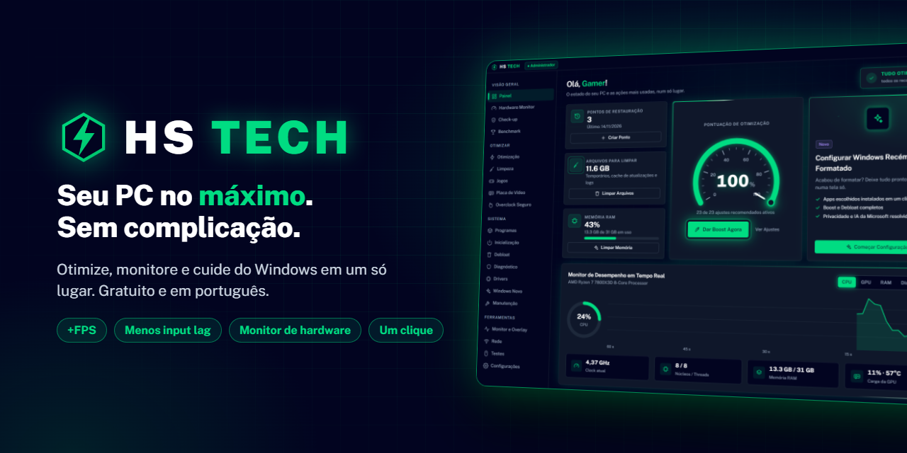
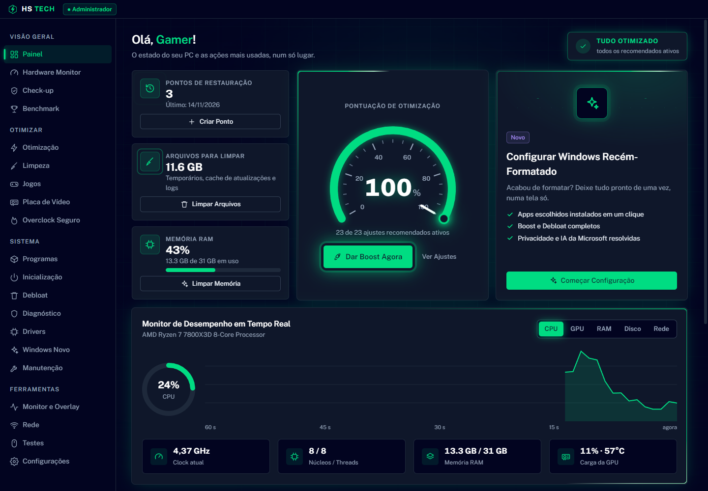
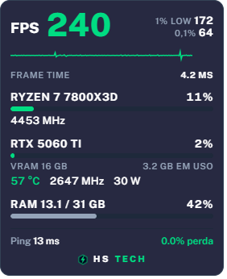
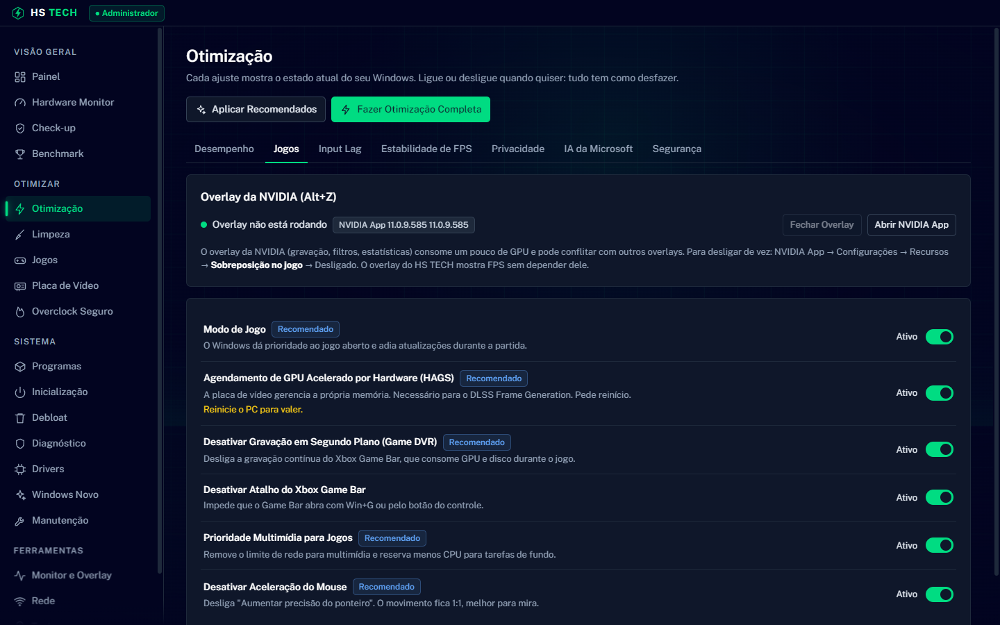
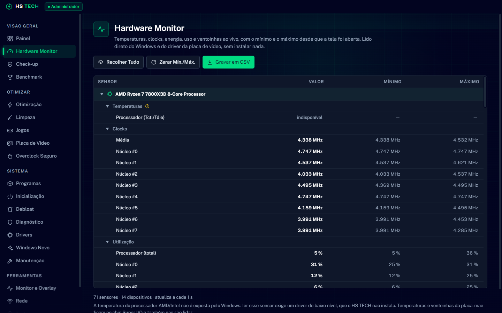
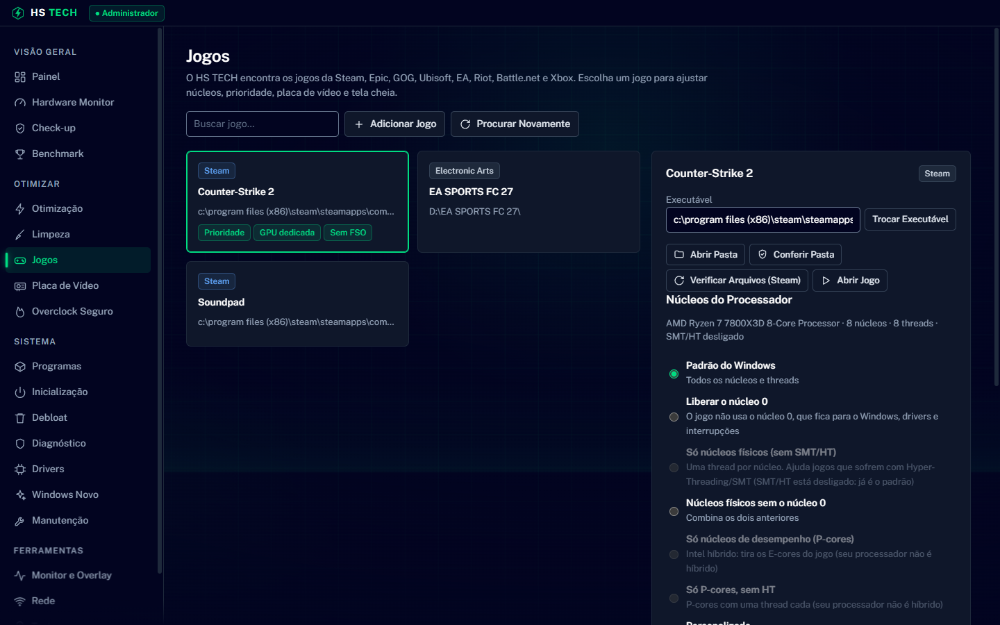
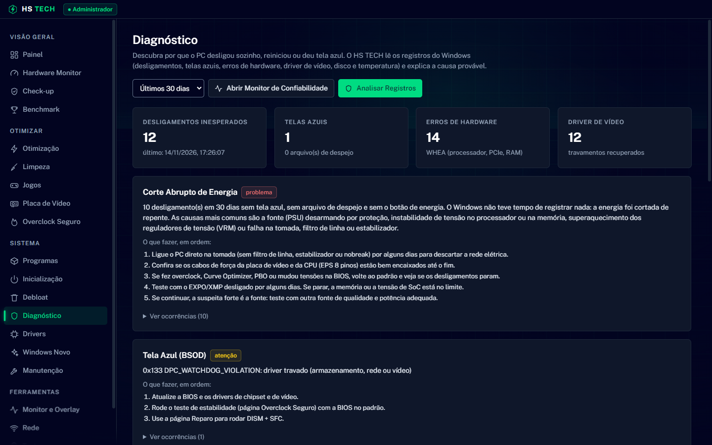
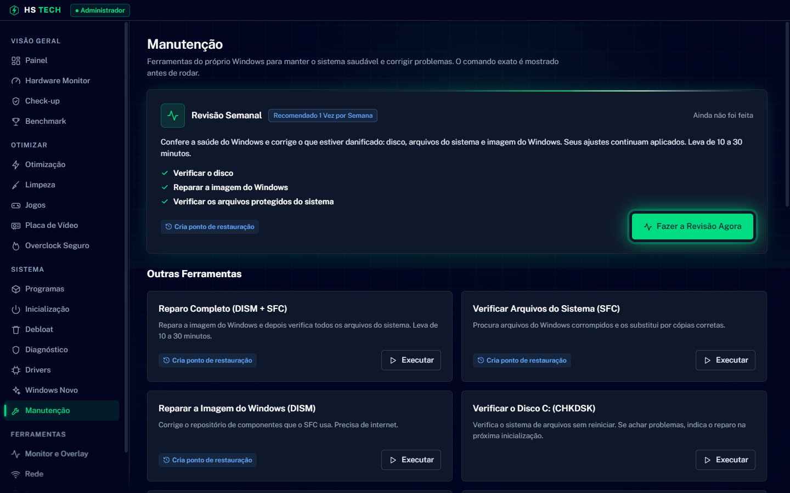
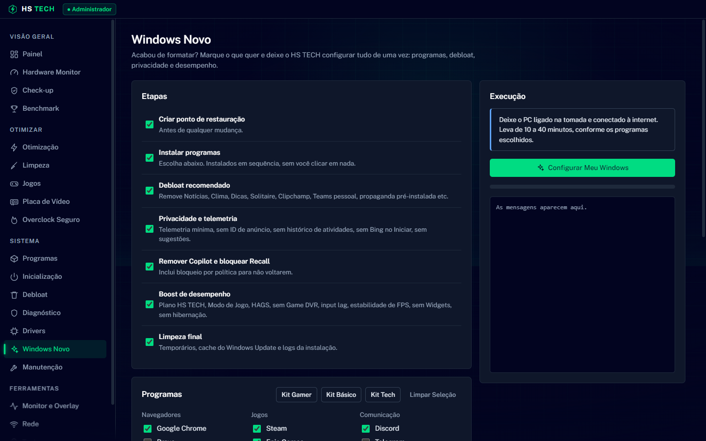
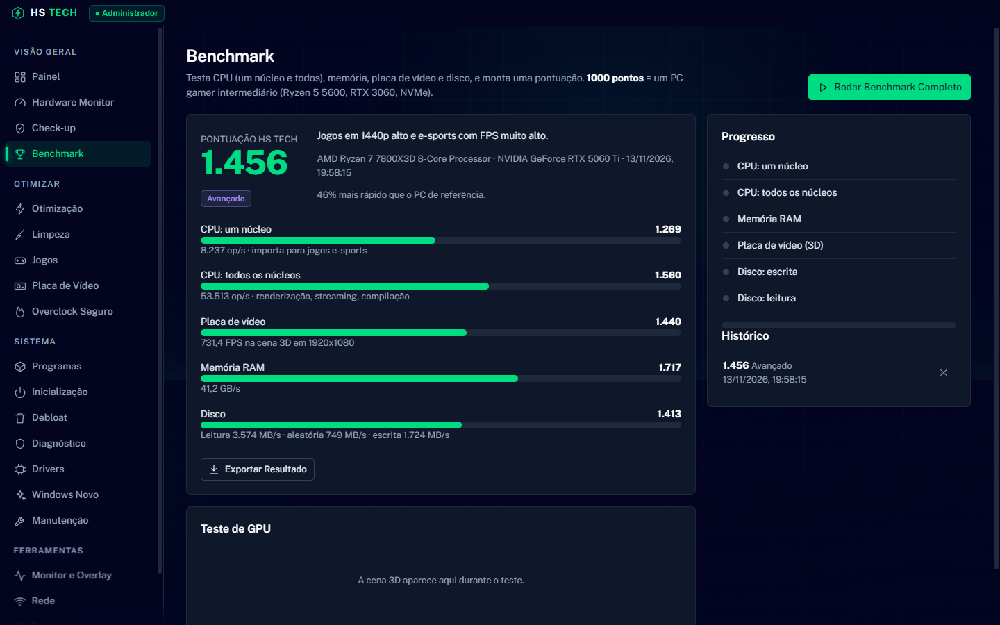

<p align="center">
  
</p>

<h1 align="center">Seu PC mais rápido, mais estável e sob controle.</h1>

<p align="center">
  O <b>HS TECH</b> reúne em um só app tudo o que você usaria cinco programas diferentes para fazer:<br>
  otimizar o Windows, ganhar FPS, ver o que acontece no hardware e resolver problemas.<br>
  <b>Gratuito, em português e sem anúncios.</b>
</p>

<p align="center">
  <a href="https://github.com/herbeth98/hs-tech/releases/download/v1.0.0/HS-TECH-Setup-1.0.0.exe"></a>
  &nbsp;
  <a href="https://github.com/herbeth98/hs-tech/releases/download/v1.0.0/HS-TECH-Portatil-1.0.0.exe"></a>
</p>

<p align="center">
  
  
  
  
  
  
</p>

<br>

## ⚡ Um clique para deixar tudo no lugar

Abriu o app, viu a nota. O **acelerador de otimização** mostra, de 0 a 100, quanto do seu Windows já está ajustado. Apertou **Dar Boost Agora**, ele cria um ponto de restauração (se você quiser), aplica os ajustes recomendados, limpa o que sobra e libera a memória RAM.

Na mesma tela: monitor em tempo real, limpeza de arquivos e da RAM com um clique, pontos de restauração e as informações do seu PC.

<p align="center"></p>

<br>

## 🎮 Feito para quem joga

<table>
<tr>
<td width="62%">

**Mais FPS, menos input lag, menos travadinha.** Cada ajuste mostra se está ligado no seu Windows e pode ser desfeito a qualquer momento.

- **Plano de energia HS TECH**: CPU sempre no máximo, sem estacionamento de núcleos
- **Input lag**: prioridade para o jogo, timer de alta resolução, USB sem economia de energia
- **Estabilidade de FPS**: sem Power Throttling, sem gravação em segundo plano
- **Por jogo**: liberar o núcleo 0, usar só núcleos físicos, prioridade alta e GPU dedicada
- **Placa de vídeo NVIDIA**: modo de desempenho máximo, baixa latência e limite de FPS direto no driver

</td>
<td width="38%" align="center">

<br>
<sub><b>Overlay por cima do jogo</b><br>FPS, 1% e 0,1% low, frame time, CPU, GPU, RAM e ping, ao vivo.</sub>

</td>
</tr>
</table>

<p align="center"></p>

<br>

## 📊 Veja tudo o que acontece dentro do PC

O **Hardware Monitor** mostra cada núcleo da CPU, a placa de vídeo, a memória, os discos (com temperatura) e a rede, com o valor atual, o mínimo e o máximo. Precisa analisar depois? Grave tudo em CSV e abra no Excel.

<p align="center"></p>

<br>

## 🕹️ Seus jogos, reconhecidos sozinhos

Steam, Epic, GOG, Ubisoft, EA, Riot, Battle.net e Xbox. O HS TECH encontra os jogos instalados e deixa você ajustar cada um: núcleos do processador, prioridade, placa de vídeo, tela cheia e até criar um atalho já otimizado.

<p align="center"></p>

<br>

## 🛠️ Quando algo dá errado, ele explica

**Seu PC desligou sozinho?** O **Diagnóstico** lê os registros do Windows e diz o motivo provável (corte de energia, tela azul, erro de hardware, driver de vídeo) e o que fazer, em ordem.

**O Windows está estranho?** A **Manutenção** tem a revisão semanal (disco, arquivos do sistema e imagem do Windows) e ferramentas para internet, Windows Update, impressora e áudio. O comando exato aparece antes de rodar.

<table>
<tr>
<td width="50%"></td>
<td width="50%"></td>
</tr>
</table>

<br>

## ✨ Acabou de formatar?

Marque o que quer e deixe o HS TECH fazer o resto: instala seus programas (Chrome, Steam, Discord, 7-Zip, VLC…), remove os apps desnecessários, desliga a telemetria, o Copilot e o Recall, e aplica o boost de desempenho. Tudo em uma tela.

<p align="center"></p>

<br>

## 🧰 E tem mais

| | | |
|:---|:---|:---|
| 🏆 **Benchmark** com pontuação e nível do seu PC | 🧹 **Limpeza** de temporários, caches e logs | 🚀 **Inicialização** mais leve |
| 🩺 **Check-up** com nota de 0 a 100 | 🗑️ **Debloat** dos apps que vêm com o Windows | 📦 **Programas**: instalar e atualizar tudo com um clique |
| 🔥 **Overclock seguro** com teste de estabilidade | 🧩 **Drivers**: erros, atualizações e backup | 🌐 **Rede**: velocidade, ping e perda de pacotes |
| 🖱️ **Testes** de mouse, monitor e teclado | 🧠 **XMP/EXPO**: confere se a RAM está na velocidade certa | 🛡️ **Privacidade**: telemetria, anúncios e IA da Microsoft |

<p align="center"></p>

<br>

## 🔒 Seguro por padrão

- **Tudo pode ser desfeito.** Cada ajuste tem um botão para voltar ao que era.
- **Ponto de restauração** antes das mudanças grandes, com um clique.
- **Nada é enviado para fora.** O HS TECH só se conecta à internet quando você pede (teste de velocidade, instalar programas, procurar drivers).
- **Código aberto (licença MIT).** Está tudo aqui, para quem quiser conferir, estudar ou melhorar.
- **Sem drivers escondidos.** O app usa só o que o próprio Windows oferece.

<br>

## ❓ Perguntas frequentes

<details>
<summary><b>É gratuito mesmo?</b></summary>
<br>
Sim. Sem versão paga, sem anúncios e sem cadastro.
</details>

<details>
<summary><b>O Windows mostrou "O Windows protegeu o computador". É seguro?</b></summary>
<br>
Esse aviso aparece em programas sem assinatura digital paga. Clique em <b>Mais informações → Executar assim mesmo</b>. O código completo está neste repositório.
</details>

<details>
<summary><b>Por que ele pede para rodar como administrador?</b></summary>
<br>
Ajustes do Windows, limpeza de pastas do sistema, reparos e a leitura de FPS só funcionam com permissão de administrador.
</details>

<details>
<summary><b>Instalador ou versão portátil?</b></summary>
<br>
O <b>instalador</b> cria atalhos e fica no seu PC. A <b>versão portátil</b> roda direto, sem instalar, e pode ir num pendrive.
</details>

<details>
<summary><b>Funciona com placa de vídeo AMD ou Intel?</b></summary>
<br>
Sim. Quase tudo funciona com qualquer placa. Só o perfil do driver, os limites de potência e alguns sensores da GPU são exclusivos da NVIDIA.
</details>

<details>
<summary><b>Por que não aparece a temperatura do processador?</b></summary>
<br>
O Windows não libera esse sensor sem instalar um driver de baixo nível, e o HS TECH prefere não instalar nenhum. A temperatura da placa de vídeo e dos discos aparece normalmente.
</details>

<details>
<summary><b>O overlay de FPS funciona em tela cheia?</b></summary>
<br>
Funciona em janela sem bordas e na maioria dos jogos atuais. Em jogos em tela cheia exclusiva, use o modo janela sem bordas.
</details>

<br>

<p align="center">
  <a href="https://github.com/herbeth98/hs-tech/releases/latest"></a>
</p>

<br>

---

<details>
<summary><b>👩‍💻 Para desenvolvedores</b></summary>

### Rodar pelo código

```bash
npm install
npm start
```

Rode o terminal como administrador.

### Gerar o instalador e a versão portátil

```bash
npm run dist
```

Os arquivos saem em `dist/`.

### Estrutura

```
src/
  main/            processo principal (Electron)
    main.js        janelas, IPC, bandeja, overlay, autoteste
    ps.js          executor de PowerShell e programas
    modules/       um módulo por área (tweaks, games, gpu, hwmon, memory, repair…)
  renderer/        interface
    tokens.css     tokens do design system (cores, raio, espaçamento, movimento)
    styles.css     componentes e animações
    js/pages/      uma página por arquivo
tools/             ícone, banner do README e animação de teste do overlay
docs/images/       imagens deste README
```

### Notas técnicas

- FPS via [PresentMon](https://github.com/GameTechDev/PresentMon) da Intel, baixado pelo próprio app.
- Animações decorativas pausam com a janela fora de foco; respeita "reduzir movimento" do Windows.
- Dados do app em `%APPDATA%\HS TECH`.
- Autoteste: `HSTECH_SELFTEST=<pasta> npx electron .` (com `HSTECH_DEMO=1`, esconde nome de usuário e do computador nas capturas).
- Banner: `npx electron tools/banner/render.js`.

</details>
