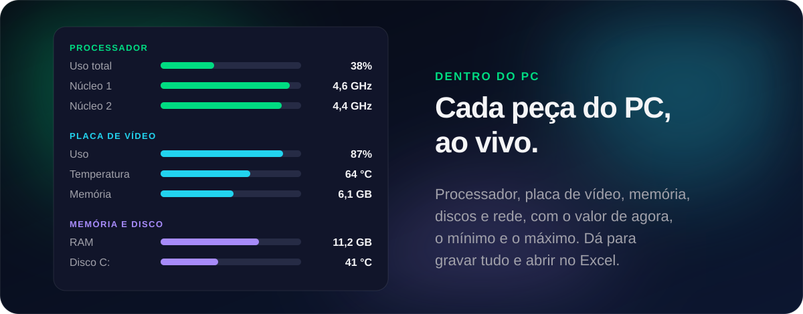

  

  

  Um app só para deixar o Windows mais rápido, ver o que acontece dentro do PC 
  e resolver problemas, em português, sem anúncios e sem cadastro.

  

 

  
  
  
  
  
  

 

  

 

<h2 align="center">Comece em três passos</h2>

  

<b>O Windows avisou "O Windows protegeu o computador". E agora?</b>

 
O programa não tem uma assinatura digital paga, então o Windows mostra esse aviso. Clique em <b>Mais informações</b> e depois em <b>Executar assim mesmo</b>. Ele também pede permissão de administrador, porque os ajustes do Windows, a limpeza e a leitura de FPS precisam dela.

<b>Meu computador dá conta?</b>

 

| | |
|---|---|
| Sistema | Windows 10 ou 11, 64 bits |
| Memória | 4 GB de RAM ou mais |
| Espaço | uns 300 MB |
| Placa de vídeo | qualquer uma. Com NVIDIA, aparecem ajustes extras do driver |
| Internet | só para o teste de velocidade, instalar programas e procurar drivers |

<b>Como atualizo ou removo?</b>

 
Para atualizar, baixe a versão nova e rode o instalador por cima. Na versão portátil, é só trocar o arquivo. Para remover, use <b>Configurações → Aplicativos</b> do Windows. Se quiser o Windows como era antes, use o botão de desfazer dos ajustes antes de remover.

<b>Quanto tempo leva?</b>

 
O Boost leva menos de um minuto. A limpeza depende de quanto lixo tem no PC, em geral alguns minutos. A revisão semanal da Manutenção confere o disco e os arquivos do Windows e pode levar de 15 a 40 minutos. Você pode continuar usando o PC enquanto isso.

<b>Funciona com placa de vídeo AMD ou Intel?</b>

 
Sim. Quase tudo funciona com qualquer placa. Só os perfis do driver e alguns sensores da placa de vídeo são exclusivos da NVIDIA.

 

  

  
    <a href="docs/MANUAL.md">Manual completo</a> ·
    <a href="docs/TECNICO.md">Como funciona por dentro</a> ·
    <a href="https://github.com/herbeth98/hs-tech/releases">Todas as versões</a>
  

